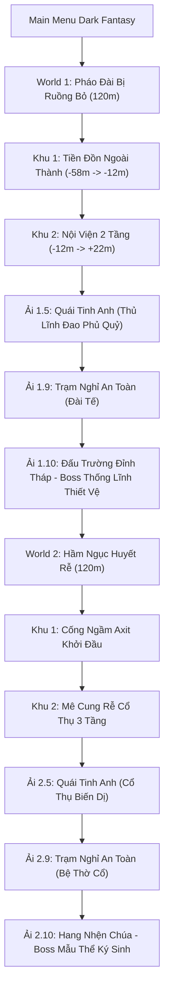

# TỔNG QUAN DỰ ÁN: PROJECT DUAL BLADE (HeroFD)
> **Báo cáo tình trạng dự án thời điểm hiện tại**  
> *Cập nhật ngày: Tháng 10/2026*  
> *Định dạng: 2.5D Cel-Shaded / HD-2D Action RPG*

---

## 1. GIỚI THIỆU & ĐỊNH HƯỚNG DỰ ÁN

- **Tên dự án:** Project Dual Blade (`HeroFD`).
- **Engine phát triển:** [Godot Engine 4.7](https://godotengine.org/) (Sử dụng bộ dựng hình **Forward+ Renderer** tối ưu chiều sâu, bóng đổ thời gian thực, SSAO, SSIL, Volumetric Fog và Spatial Shaders).
- **Thể loại:** 2.5D Side-scrolling Action RPG / Boss Rush kết hợp Roguelite Progression.
- **Phong cách đồ họa (Art Style):** **2.5D Cel-Shaded / HD-2D** (lấy cảm hứng từ *Octopath Traveler*, *Ender Lilies*, *Nine Sols*, *Blasphemous*).
  - Tích hợp Sprite hoạt họa 16-bit / Hi-Res Pixel Art trên các thực thể [`Sprite3D`](file:///Users/fregd/Documents/code/HeroFD/src_3d/player/Player3D.gd) đặt trong không gian 3D.
  - Sử dụng ánh sáng thời gian thực (Directional Light, Torch OmniLight, ngọn lửa vạc than Gothic nhấp nháy [`BrazierFire3D.gd`](file:///Users/fregd/Documents/code/HeroFD/src_3d/environment/BrazierFire3D.gd)), bóng đổ đổ xuống sàn gạch đá, Shader Cel-Toon 3 nấc tương phản và Inverted Hull Outline viền đen sắc sảo.
  - Chiều sâu trường ảnh điện ảnh (Depth of Field Bokeh), sương mù thể tích (Volumetric Fog) và bụi tro tàn khí quyển lơ lửng ([`AtmosphericEmbers3D.gd`](file:///Users/fregd/Documents/code/HeroFD/src_3d/vfx/AtmosphericEmbers3D.gd) & [`AtmosphericSpores3D.gd`](file:///Users/fregd/Documents/code/HeroFD/src_3d/vfx/AtmosphericSpores3D.gd)).
- **Quy tắc không gian (2.5D Plane Constraint):**
  - **Khóa cứng trục $Z = 0$ tuyệt đối** trong `_physics_process` cho người chơi, kẻ địch, đạn và vật phẩm rơi.
  - Camera 2.5D đặt tại $Z = 7.5$, góc nhìn $50^\circ$, có tính năng lerp bám đuổi, nhìn đón đầu (look-ahead), kẹp biên an toàn $[-52, 54]$, hiệu ứng rung chấn màn hình (Screen Shake) và tự động mở rộng góc nhìn khi đấu Boss (Boss Mode Zoom).

---

## 2. KIẾN TRÚC MÃ NGUỒN & HỆ THỐNG THƯ MỤC

Dự án đã được dọn dẹp sạch sẽ 100%, loại bỏ hoàn toàn các file 2D cũ lỗi thời, phân tách rõ ràng giữa nền tảng 3D hiện đại và các hệ thống data/logic dùng chung:

```
HeroFD/
├── data/                          # Dữ liệu cân bằng JSON (chỉ số quái, công thức loot, option pool)
├── assets/
│   ├── sprites/                   # Sprite sheet nhân vật, quái vật World 1 & World 2, bối cảnh, UI
│   └── fonts/                     # Font chữ Gothic / Pixel Art
├── src_3d/                        # Logic & Thực thể 2.5D Cel-Shaded
│   ├── audio/                     # SoundManager3D.gd (Tổng hợp âm thanh 16-bit procedural, 0 dependency)
│   ├── player/                    # Player3D.gd (FSM, Combo, Dash, Parry, Wall Slide, Hit-stop)
│   ├── camera/                    # Camera25D.gd (Follow mượt, DoF Bokeh, Shake, Boss Mode Zoom)
│   ├── combat/                    # StageManager3D.gd (Quản lý ải 1.1 -> 1.10, 2.1 -> 2.10, spawn quái)
│   ├── enemies/                   # EnemyBase3D.gd, Lính gác, Cung thủ, Chó săn, Đao phủ, Bào tử, Rễ máu, Bọ axit, Cổ thụ biến dị
│   ├── bosses/                    # BossIroncladCommander3D.gd (Boss 1.10), BossParasiticMatriarch3D.gd (Boss 2.10)
│   ├── items/                     # DropItem3D.gd (Vật phẩm rơi 3D, hút nam châm, cột sáng phẩm cấp)
│   ├── projectiles/               # ArrowProjectile3D.gd, AcidGlobProjectile3D.gd
│   ├── shaders/                   # cel_toon, outline, slash_arc, void_vortex, sprite_cel_toon
│   ├── vfx/                       # HitSparks3D, AtmosphericEmbers3D, AtmosphericSpores3D, DamageNumber3D, GhostTrail3D
│   ├── environment/               # BrazierFire3D.gd, SpikeTrap3D.gd, AcidPoolHazard3D.gd, BouncyMushroom3D.gd
│   ├── world/                     # Portal3D.gd, SafeHavenAltar3D.gd, SpawnPoint3D.gd, PlayerStart3D.gd
│   └── ui/                        # HUD3D.gd (Thanh máu Gothic, Giáp, Ngọc Flow, Thanh Boss)
├── scenes_3d/                     # Các Scene 2.5D lắp ráp hoàn chỉnh
│   ├── World1_Bastion_3D.tscn     # Màn chơi 120m Cổ Thành Bastion (3 Phân Khu Rõ Rệt, bục ngai Boss)
│   ├── World2_Crimson_Catacombs_3D.tscn # Màn chơi 120m Hầm Ngục Huyết Rễ (Đầm axit, nấm nhún, rễ cây)
│   ├── Player3D.tscn              # Nhân vật chính 2.5D tích hợp VisualRoot & SlashArc
│   ├── EnemyRustyGuard3D.tscn, EnemyArcher3D.tscn, EnemyChainHound3D.tscn, EnemyEliteExecutioner3D.tscn
│   ├── EnemySporeShambler3D.tscn, EnemyRootLurker3D.tscn, EnemyAcidSpitter3D.tscn, EnemyEliteMutatedTree3D.tscn
│   ├── BossIroncladCommander3D.tscn, BossParasiticMatriarch3D.tscn
│   ├── AcidPoolHazard3D.tscn, BouncyMushroom3D.tscn, SpikeTrap3D.tscn
│   └── Portal3D.tscn, DropItem3D.tscn, SafeHavenAltar3D.tscn
├── src/                           # Logic & Dữ liệu cốt lõi dùng chung (Core Systems)
│   ├── combat/                    # DamageCalculator.gd
│   ├── items/                     # MergeSystem.gd (Ghép 5-thành-1), ArmorSystem.gd, ShieldSystem.gd, WeaponOptionGenerator.gd
│   ├── world/                     # CheckpointManager.gd
│   └── ui/                        # InventoryUI.gd, FastTravelMapUI.gd, MainMenu.gd
├── scenes/                        # Giao diện màn hình UI dùng chung
│   ├── MainMenu.tscn              # Menu chính Dark Fantasy
│   ├── InventoryUI.tscn           # Túi đồ [B] & trang bị
│   └── FastTravelMapUI.tscn       # Bản đồ du hành nhanh [M]
└── tests/                         # Bộ kiểm thử tự động (100% Pass)
    ├── test_milestone1_spawn_system.gd
    ├── test_stage_portal.gd
    ├── test_auto_equip_and_merge.gd
    ├── test_fast_travel.gd
    └── test_world2_progression.gd
```

---

## 3. CÁC THẾ GIỚI HOÀN CHỈNH TRONG GAME



### 3.1. World 1: Pháo Đài Bị Ruồng Bỏ (The Forsaken Bastion)
- **Kiến trúc 3 Phân Khu Rõ Rệt:**
  1. **Khu 1: Tiền Đồn Ngoài Thành ($X \in [-58, -12]$):** Hàng rào chông sắt Gothic, bục gác quan sát cao $3.2\text{m}$, bẫy chông sàn, vạc lửa than bập bùng, kết thúc bằng Cổng Vòm Ngoại Thành (`ArchOuterGate`) tại $X = -13.5\text{m}$.
  2. **Khu 2: Nội Viện Thành Trì 2 Tầng ($X \in [-12, +22]$):** Hệ thống cầu thang nêm dốc mượt mà dẫn lên tầng 2 ($Y = 3.75\text{m}$), cầu vòm đá hoa cương trung tâm $12\text{m}$, 4 đại trụ $16\text{m}$, kết thúc bằng Cổng Vòm Hoàng Gia (`ArchRoyalGate`) tại $X = 22.0\text{m}$.
  3. **Khu 3: Đấu Trường Đỉnh Tháp Tử Chiến ($X \in [+22, +58]$):** Khu đài tế an toàn 1.9, sân phẳng lỳ cơ động, và **Bục Ngai Vàng Hoàng Gia (`BossThroneDais`)** nâng cao $0.9\text{m}$ tại $X \in [49, 57]$ - nơi Đại Trùm Boss 1.10 Thống Lĩnh Thiết Vệ uy nghiêm ngự trị.
- **Kẻ địch World 1:** Lính Gác Rỉ Sét, Cung Thủ Tháp Canh, Chó Săn Xích Sắt.
- **Ải 1.5 (Quái Tinh Anh):** Thủ Lĩnh Đao Phủ Quỷ (đòn vung búa nặng báo đỏ unparryable).
- **Ải 1.10 (Đại Trùm):** Thống Lĩnh Thiết Vệ (3,800 HP, 2 Phase: Đại Kiếm -> Song Kiếm Cuồng Nộ).

### 3.2. World 2: Hầm Ngục Huyết Rễ (The Crimson Catacombs)
- **Kiến trúc & Môi trường hiểm trở:**
  - Cống ngầm đan xen rễ cây khổng lồ phát sáng đỏ máu, bào tử đỏ tím lơ lửng, sương mù thể tích ma quái.
  - **Hồ Axit Ăn Mòn ([`AcidPoolHazard3D.tscn`](file:///Users/fregd/Documents/code/HeroFD/scenes_3d/AcidPoolHazard3D.tscn)):** Bào mòn giáp người chơi theo thời gian thực nếu đứng vào.
  - **Búp Nấm Nhún Nảy ([`BouncyMushroom3D.tscn`](file:///Users/fregd/Documents/code/HeroFD/scenes_3d/BouncyMushroom3D.tscn)):** Co dãn cao su khi giẫm vào và bật nảy nhân vật lên $16.5\text{m/s}$ để tiếp cận các tầng rễ cây cao.
- **Kẻ địch World 2:**
  - **Bào Tử Nhảy ([`EnemySporeShambler3D`](file:///Users/fregd/Documents/code/HeroFD/src_3d/enemies/EnemySporeShambler3D.gd)):** Tích tụ độc tố phồng to và nổ phát tán bào tử độc.
  - **Ấu Trùng Rễ Máu ([`EnemyRootLurker3D`](file:///Users/fregd/Documents/code/HeroFD/src_3d/enemies/EnemyRootLurker3D.gd)):** Tốc độ $6.8\text{m/s}$, bò sát đất phóng vồ (Pounce) chớp nhoáng.
  - **Bọ Phun Axit ([`EnemyAcidSpitter3D`](file:///Users/fregd/Documents/code/HeroFD/src_3d/enemies/EnemyAcidSpitter3D.gd)):** Phun cầu axit cầu vồng gây sát thương ăn mòn từ xa.
- **Ải 2.5 (Quái Tinh Anh):** Cổ Thụ Biến Dị ([`EnemyEliteMutatedTree3D`](file:///Users/fregd/Documents/code/HeroFD/src_3d/enemies/EnemyEliteMutatedTree3D.gd) — 1,800 HP, triệu hồi gai rễ từ dưới sàn và phun phấn độc diện rộng).
- **Ải 2.10 (Đại Trùm):** Mẫu Thể Ký Sinh ([`BossParasiticMatriarch3D`](file:///Users/fregd/Documents/code/HeroFD/src_3d/bosses/BossParasiticMatriarch3D.gd) — 6,200 HP, DEF 8: Phase 1 bám trần dộng vuốt nhọn; Phase 2 rơi xuống sàn gầm thét cuồng nộ, quét chân liên hoàn & sinh bầy ấu trùng).

---

## 4. HỆ THỐNG ÂM THANH & HIỆU ỨNG VFX ĐẶC SẮC

1. **Hệ Thống Âm Thanh Procedural 16-Bit ([`SoundManager3D.gd`](file:///Users/fregd/Documents/code/HeroFD/src_3d/audio/SoundManager3D.gd)):**
   - 12 âm thanh Dark Fantasy được tổng hợp bằng `AudioStreamWAV` thuần, 0 dependency, không lo thiếu file âm thanh:
     * 4 nhát chém Song Đao khác biệt (Slash 1-4)
     * Tiếng chém trúng quái (Hit) & Tiếng nổ chí mạng (Crit)
     * Tiếng kim loại vang đanh khi Cross-Parry thành công
     * Tiếng lướt hư ảnh Shadow Dash
     * Tiếng bước nhảy & Tiếng cắm đao bổ nhào Spinning Dive
     * Tiếng uống bình máu & Tiếng rơi vật phẩm (Mercy Drop)
     * Tiếng gầm kinh thiên động địa của Boss (Boss Roar)
     * Tiếng cổng không gian mở (Portal Warp) & Tiếng chuông khải hoàn thắng trận (Victory Bell)
2. **Hiệu Ứng Hình Ảnh & Khí Quyển (VFX):**
   - **Tia lửa va chạm 3D ([`HitSparks3D.gd`](file:///Users/fregd/Documents/code/HeroFD/src_3d/vfx/HitSparks3D.gd)):** Bắn tia lửa Additive Unshaded theo hướng vung kiếm; bùng nổ tia lửa vàng rực khi Parry.
   - **Bụi tro tàn Gothic ([`AtmosphericEmbers3D.gd`](file:///Users/fregd/Documents/code/HeroFD/src_3d/vfx/AtmosphericEmbers3D.gd)):** Tàn than vàng cam trôi lơ lửng khắp pháo đài World 1.
   - **Bào tử huyết sắc ([`AtmosphericSpores3D.gd`](file:///Users/fregd/Documents/code/HeroFD/src_3d/vfx/AtmosphericSpores3D.gd)):** Bào tử đỏ tím ma mị bồng bềnh khắp hầm ngục World 2.
   - **Ngọn lửa vạc than Gothic ([`BrazierFire3D.gd`](file:///Users/fregd/Documents/code/HeroFD/src_3d/environment/BrazierFire3D.gd)):** Ngọn lửa sống động nhấp nháy sóng sin đôi kèm tàn lửa bốc lên.
   - **Số sát thương bay ([`DamageNumber3D.gd`](file:///Users/fregd/Documents/code/HeroFD/src_3d/vfx/DamageNumber3D.gd)):** Trắng (thường), Đỏ (chí mạng), Vàng kim ("PARRY!").
   - **Hit-Stop Micro Pause:** Khựng màn hình $0.05 - 0.08\text{s}$ khi ra đòn kết liễu hoặc phản đòn thành công.

---

## 5. HỆ THỐNG ĐIỀU KHIỂN & PHÍM TẮT TRONG GAME

| Phím Bấm | Hành Động | Ghi Chú Kỹ Thuật |
| :--- | :--- | :--- |
| **A / D** | Di chuyển trái / phải | Khóa trục Z=0 tuyệt đối |
| **Space** | Nhảy / Nhảy đúp (Double Jump) | Đạp tường khi chạm vách (Wall Jump) |
| **J** | Tấn công Song Đao | Combo 4 đòn; Air combo khi ở trên không; kèm Hit-stop & Tia lửa |
| **S + J** (Trên không) | Bổ nhào (Spinning Dive) | Cắm đao dậm sàn, nảy lên khi trúng quái |
| **L** | Lướt Hư Ảnh (Shadow Dash) | Lướt xuyên quái vật, i-frame toàn bộ quá trình |
| **K** | Phản Đòn (Cross-Parry) | Khung 0.16s; nổ tia lửa vàng, làm choáng và chém phản đòn sau lưng |
| **I** | Tuyệt Kỹ (Blade Dance) | Kích hoạt bão đao khi thanh Flow đầy ngọc |
| **B** | Mở / Đóng Túi Đồ (Inventory) | Trang bị, xem chỉ số, gợi ý ghép 5-thành-1 |
| **M** | Bản Đồ Du Hành Nhanh (Fast Travel) | Chọn Checkpoint và xem các World đã mở |
| **E** | Tương tác môi trường | Dùng Đài Tế hồi phục tại ải X.9, qua Cổng dịch chuyển |
| **F3** | Debug HUD Overlay | Bật/tắt bảng thông số thời gian thực (Player pos, 14 SpawnPoints, quái sống) |

---

## 6. LỘ TRÌNH KẾ HOẠCH BƯỚC TIẾP THEO (ROADMAP)

- [x] **P0 — Nền Tảng Kỹ Thuật 2.5D Cel-Shaded & Dọn Dẹp Mã Nguồn** *(Hoàn thành)*
- [x] **P1 — Core Combat Song Đao, Sound FX 16-Bit & Hit Sparks** *(Hoàn thành)*
- [x] **P2 — Gothic HUD, Túi Đồ [B] & Gợi Ý Ghép Đồ 5-thành-1** *(Hoàn thành)*
- [x] **P3 — World 1: Pháo Đài Bị Ruồng Bỏ (3 Phân Khu Rõ Rệt, Ngai Vàng Boss)** *(Hoàn thành)*
- [x] **P4 — World 1 Quái Tinh Anh 1.5 & Boss 1.10 Thống Lĩnh Thiết Vệ** *(Hoàn thành)*
- [x] **P5 — World 2: Hầm Ngục Huyết Rễ (Đầm Axit, Nấm Nhún, Bào Tử, Rễ Máu)** *(Hoàn thành)*
- [x] **P6 — World 2 Quái Tinh Anh Cổ Thụ 2.5 & Boss Mẫu Thể Ký Sinh 2.10** *(Hoàn thành)*
- [ ] **P7 — World 3: Tháp Đồng Hồ Cơ Giới (The Clockwork Spire):**
  - Sàn bánh răng xoay 3D, bẫy cưa máy, tia laser quét định kỳ.
  - Quái Robot tuần tra, Turret piston, Bầy ong cơ khí.
  - Quái Tinh Anh Cỗ Máy Hộ Vệ Lõi (3.5) & Đại Trùm Kẻ Hành Quyết Cơ Giới (3.10).
- [ ] **P8 — World 4: Đền Thờ Hư Vô (The Void Sanctum) & Trùm Cuối Kẻ Thao Túng Hư Không (4.10).**
- [ ] **P9 — Hệ Thống NPC Thợ Rèn & Shop Nâng Cấp tại Trạm Nghỉ An Toàn (X.9).**

---

## 7. CÁCH KHỞI CHẠY DỰ ÁN

1. **Khởi chạy trực tiếp từ Terminal:**
   ```bash
   ./run_demo.command          # Mở menu lựa chọn tương tác
   ./run_demo.command w1       # Khám phá World 1 (Ải 1.1)
   ./run_demo.command boss1    # Vào thẳng Boss 1.10: Thống Lĩnh Thiết Vệ
   ./run_demo.command w2       # Khám phá World 2 (Ải 2.1)
   ./run_demo.command boss2    # Vào thẳng Boss 2.10: Mẫu Thể Ký Sinh
   ./run_demo.command elite2   # Vào thẳng Quái Tinh Anh 2.5: Cổ Thụ Biến Dị
   ./run_demo.command test     # Chạy tự động toàn bộ 5 bộ kiểm thử tự động
   ```
2. **Khởi chạy từ Finder:**
   - Click đúp chuột vào file [`run_demo.command`](file:///Users/fregd/Documents/code/HeroFD/run_demo.command) để mở cửa sổ lựa chọn và chơi ngay!
3. **Mở qua Godot Editor:**
   - Mở Godot Engine 4.7+, chọn `Import` và dẫn đường dẫn tới thư mục `HeroFD/project.godot`.
