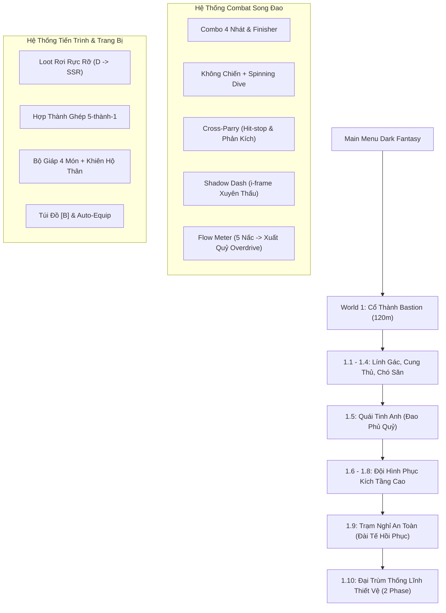

# TỔNG QUAN DỰ ÁN: PROJECT DUAL BLADE (HeroFD)
> **Báo cáo tình trạng dự án thời điểm hiện tại**  
> *Cập nhật ngày: Tháng 10/2026*  
> *Định dạng: 2.5D Cel-Shaded / HD-2D Action RPG*

---

## 1. GIỚI THIỆU & ĐỊNH HƯỚNG DỰ ÁN

- **Tên dự án:** Project Dual Blade (`HeroFD`).
- **Engine phát triển:** [Godot Engine 4.7](https://godotengine.org/) (Sử dụng bộ dựng hình **Forward+ Renderer** tối ưu chiều sâu, bóng đổ thời gian thực và Spatial Shaders).
- **Thể loại:** 2.5D Side-scrolling Action RPG / Boss Rush kết hợp Roguelite Progression.
- **Phong cách đồ họa (Art Style):** **2.5D Cel-Shaded / HD-2D** (lấy cảm hứng từ *Octopath Traveler*, *Ender Lilies*, *Nine Sols*).
  - Tích hợp Sprite hoạt họa 16-bit / Hi-Res Pixel Art trên các thực thể [`Sprite3D`](file:///Users/fregd/Documents/code/HeroFD/src_3d/player/Player3D.gd) đặt trong không gian 3D.
  - Sử dụng ánh sáng thời gian thực (Directional Light, Torch OmniLight), bóng đổ đổ xuống sàn gạch đá, Shader Cel-Toon 3 nấc tương phản và Inverted Hull Outline viền đen sắc sảo.
- **Quy tắc không gian (2.5D Plane Constraint):**
  - **Khóa cứng trục $Z = 0$ tuyệt đối** trong `_physics_process` cho người chơi, kẻ địch, đạn và vật phẩm rơi.
  - Camera 2.5D đặt tại $Z = 9.5$, chúc nhẹ $-2.5^\circ$, có tính năng lerp bám đuổi, nhìn đón đầu (look-ahead) và rung màn hình (screen shake).

---

## 2. KIẾN TRÚC MÃ NGUỒN & HỆ THỐNG THƯ MỤC

Dự án được phân tách rõ ràng giữa nền tảng 3D hiện đại và các hệ thống data/logic dùng chung:

```
HeroFD/
├── data/                          # Dữ liệu cân bằng JSON (chỉ số quái, công thức loot, option pool)
├── assets/
│   ├── sprites/                   # Sprite sheet nhân vật, quái vật, đạo cụ, bối cảnh, UI
│   └── fonts/                     # Font chữ Gothic / Pixel Art
├── src_3d/                        # Logic & Thực thể 2.5D
│   ├── player/                    # Player3D.gd (FSM, Combo, Dash, Parry, Wall Slide)
│   ├── camera/                    # Camera25D.gd (Follow mượt, Shake, Look-ahead)
│   ├── combat/                    # StageManager3D.gd (Quản lý ải 1.1 -> 1.10, wave, spawn)
│   ├── enemies/                   # EnemyBase3D.gd, Lính gác, Cung thủ, Chó săn, Đao phủ
│   ├── bosses/                    # BossIroncladCommander3D.gd (Boss 1.10 2 Phase)
│   ├── items/                     # DropItem3D.gd (Vật phẩm rơi 3D, hút nam châm, cột sáng phẩm cấp)
│   ├── shaders/                   # cel_toon, outline, slash_arc, void_vortex
│   ├── vfx/                       # GhostTrail3D, SlashArc3D, DamageNumber3D, SummonEffect3D
│   ├── world/                     # Portal3D.gd, SafeHavenAltar3D.gd, SpikeTrap3D.gd
│   └── ui/                        # HUD3D.gd (Thanh máu Gothic, Giáp, Ngọc Flow, Thanh Boss)
├── scenes_3d/                     # Các Scene 2.5D lắp ráp hoàn chỉnh
│   ├── World1_Bastion_3D.tscn     # Màn chơi 120m Cổ Thành Bastion (Đấu trường 4 tầng, cầu vòm)
│   ├── Player3D.tscn              # Nhân vật chính 2.5D tích hợp VisualRoot & SlashArc
│   ├── BossIroncladCommander3D.tscn
│   ├── Portal3D.tscn & DropItem3D.tscn
│   └── ...
├── src/                           # Logic & Dữ liệu cốt lõi dùng chung
│   ├── combat/                    # DamageCalculator.gd, HitStopManager.gd
│   ├── items/                     # MergeSystem.gd (Ghép 5-thành-1), ArmorSystem.gd, ShieldSystem.gd
│   ├── world/                     # CheckpointManager.gd, PortalChoiceManager.gd
│   └── ui/                        # InventoryUI.gd, FastTravelMapUI.gd, MainMenu.gd
└── scenes/                        # Giao diện màn hình UI
    ├── MainMenu.tscn              # Menu chính Dark Fantasy
    ├── InventoryUI.tscn           # Túi đồ [B] & trang bị
    └── FastTravelMapUI.tscn       # Bản đồ du hành nhanh [M]
```

---

## 3. NHỮNG GÌ ĐÃ HOÀN THÀNH (ĐÃ CÓ TRONG GAME)



### 3.1. Bộ Kỹ Năng & Combat Song Đao (Dual Blades)
1. **Chuỗi Combo 4 Đòn (4-hit Combo):**
   - Đòn 1 - 2: Hai nhát chém chéo chữ X tốc độ cao.
   - Đòn 3: Xoay người chém kép theo trục ngang.
   - Đòn 4 (Finisher): Trảm cắt bạt ngang kèm lực đẩy lùi tạo khoảng cách an toàn.
2. **Không chiến (Air Combat):**
   - **Air Float:** Giữ nhân vật lơ lửng trên không 0.3s khi ra đòn chém.
   - **Spinning Dive (Bổ nhào):** Cắm đao xuống sàn; tiếp trúng đầu quái sẽ nảy ngược lên cho phép tái kích hoạt chuỗi nhảy.
3. **Cơ động môi trường (Platforming):**
   - Nhảy đơn, nhảy đúp (Double Jump).
   - Bám tường trượt chậm (Wall Slide) & đạp tường nhảy cao (Wall Jump).
4. **Lướt Hư Ảnh (Shadow Dash):**
   - Lướt xuyên qua thân thể quái vật với khung bất tử (i-frame toàn phần).
5. **Phản Đòn Bắt Chéo (Cross-Parry):**
   - Cửa sổ phản đòn chuẩn xác 0.15s (9-10 frames).
   - Khi thành công: Kích hoạt hiệu ứng dừng khung hình (Hit-stop) 0.1s, lập tức dịch chuyển tốc biến ra sau lưng đối thủ và tung đòn phản kích chí mạng.
6. **Thanh Cuồng Bạo (Flow Meter):**
   - 5 nấc ngọc Ruby. Chém trúng quái tích +1 nấc.
   - Đạt đủ 5 nấc kích hoạt trạng thái **Xuất Quỷ (Overdrive)**: +20% Tốc độ di chuyển, +20% Sát thương tổng thể, phát sáng dư ảnh đỏ thẫm.
   - Tự động tụt về 0 nếu không tấn công trong 2.5s hoặc bị dính đòn.
7. **Chiêu Thức Tất Sát (Blade Dance):**
   - Biến mất trong 0.5s, càn quét bão đao đa mục tiêu với khung bất tử tuyệt đối.

### 3.2. Hệ Thống Trang Bị & Hợp Thành (Loot & Progression)
- **7 Phẩm Cấp Hoàn Chỉnh:** `D (Xám) ➔ C (Trắng) ➔ B (Lục) ➔ A (Lam) ➔ R (Tím) ➔ SR (Vàng) ➔ SSR (Đỏ Thẫm)`.
- **Cơ chế Hợp thành 5-thành-1 ([`MergeSystem.gd`](file:///Users/fregd/Documents/code/HeroFD/src/items/MergeSystem.gd)):**
  - Cứ 5 món cùng loại, cùng bậc phẩm trong Túi Đồ có thể ghép thành 1 món thuộc bậc kế tiếp với chỉ số vượt trội và mở khóa option phụ.
- **Túi Đồ & Giao diện ([`InventoryUI.gd`](file:///Users/fregd/Documents/code/HeroFD/src/ui/InventoryUI.gd)):**
  - Phím tắt `[B]`.
  - Quản lý Song Đao, Bộ Giáp 4 món (Mũ, Áo Giáp, Hộ Thủ, Chiến Ngoa) và Khiên Hộ Thân (Shield).
  - Hỗ trợ Auto-Equip, so sánh chỉ số trang bị đang mặc và trang bị mới nhặt.
- **Công Thức Sát Thương ARPG ([`DamageCalculator.gd`](file:///Users/fregd/Documents/code/HeroFD/src/combat/DamageCalculator.gd)):**
  $$\text{Giảm Trừ (Mitigation\%)} = \frac{\text{DEF}}{\text{DEF} + 50}$$
  - Sát thương trừ vào Lớp Giáp Bảo Vệ (Armor Bar) trước rồi mới thấu vào Máu (HP Bar).
  - Tỉ lệ Đỡ Đòn (Block Rate) từ Khiên Hộ Thân và Tỉ lệ Chí Mạng (Crit Rate) tăng lũy tiến theo phẩm cấp vũ khí.

### 3.3. Màn Chơi World 1: Cổ Thành Bastion (The Bastion of Rust)
- **Thiết kế kiến trúc 120 mét:**
  - Bản đồ dài 120m, 4 tầng lầu kiến trúc Gothic kiên cố.
  - Hệ thống cầu vòm đá liên tục, bậc thang dốc chuyển tầng mượt mà, bẫy chông sàn ([`SpikeTrap3D.gd`](file:///Users/fregd/Documents/code/HeroFD/src_3d/environment/SpikeTrap3D.gd)) tách biệt.
  - Vị trí spawn người chơi tại đầu cầu đá ($X = -10$), kèm hiệu ứng vòng ma pháp triệu hồi khởi đầu ([`SummonEffect3D.gd`](file:///Users/fregd/Documents/code/HeroFD/src_3d/vfx/SummonEffect3D.gd)).
- **Vòng lặp Vượt Ải từ 1.1 đến 1.10 ([`StageManager3D.gd`](file:///Users/fregd/Documents/code/HeroFD/src_3d/combat/StageManager3D.gd)):**
  - **Ải 1.1 - 1.4:** Dọn dẹp Lính Gác Rỉ Sét, Cung Thủ canh tháp cao, Chó Săn bứt tốc.
  - **Ải 1.5 (Quái Tinh Anh):** Thủ Lĩnh Đao Phủ Quỷ (Executioner) mang cự búa chấn động sàn (Unparryable) gọi cung thủ yểm trợ.
  - **Ải 1.6 - 1.8:** Quái phục kích dày đặc trên các tầng cao.
  - **Ải 1.9 (Trạm Nghỉ An Toàn):** Safe Haven Altar cho phép bấm `[E]` hồi phục 100% HP, Giáp và 3 Bình Máu Lớn.
  - **Ải 1.10 (Đại Trùm Cuối):** Thống Lĩnh Thiết Vệ (Ironclad Commander) 3,800 HP:
    - *Phase 1:* Vung Đại Kiếm nặng, báo đỏ để luyện Cross-Parry.
    - *Phase 2:* Rút Song Kiếm Cuồng Nộ, tăng tốc độ chém bão táp.
    - *Mercy Drops:* Cứ mất 25% HP sẽ tự động rơi 2 Bình Máu Lớn hỗ trợ người chơi duy trì thế trận.
- **Cơ Chế Phân Nhánh Cổng (Portal Choice):**
  - Hoàn thành các ải thường mở ra 2 lựa chọn: **Cổng Đao Kiếm (Màu Đỏ)** (nhiều phôi vũ khí & quái dày) vs **Cổng Sinh Mệnh (Màu Lục)** (nhiều bình máu hồi phục).
- **Hệ Thống Checkpoint ([`CheckpointManager.gd`](file:///Users/fregd/Documents/code/HeroFD/src/world/CheckpointManager.gd)):**
  - Tự động lưu và cho phép du hành nhanh (`[M]`) về các mốc đã vượt: 1.1, 1.5, 1.9, 1.10.

---

## 4. NHỮNG GÌ ĐÃ VÀ ĐANG LÀM GẦN ĐÂY (IN-PROGRESS & RECENT WORK)

Trong các bản cập nhật gần nhất, dự án tập trung vào việc **hoàn thiện trải nghiệm nghe nhìn (Audiovisuals) và độ mượt mà của môi trường 2.5D**:

1. **Xử lý triệt để lỗi viền đồ họa & hộp xám (Sprite Alpha & Clean Edges):**
   - Loại bỏ hoàn toàn viền xám/trắng quanh sprite của các vật phẩm nhặt rơi, khiên bảo vệ, bẫy chông và cây đuốc kiến trúc.
   - Cấu hình chuẩn `texture_filter = 0` (Nearest) và `alpha_cut = 1` (Discard) trên toàn bộ Sprite3D để pixel art luôn sắc nét, không vỡ hạt hay bị lem bóng.
2. **Cân chỉnh cơ học di chuyển trên cầu thang & địa hình dốc:**
   - Đặt các khối trực quan của cầu vòm và bậc thang ở tiền cảnh ($Z = 0.08$), khối va chạm vật lý lùi nhẹ ($Z = -0.5$), tối ưu góc dốc giúp nhân vật bước lên cầu thang không bị khựng hay kẹt chân.
3. **Mở rộng chiều dài bản đồ World 1 lên 120m:**
   - Thay thế các đảo nổi rời rạc bằng hệ thống vòm cầu Gothic liên tục, mở rộng mật độ quái vật theo từng ải tương xứng với chiều dài bản đồ.
4. **Đồng bộ hóa vòng lặp rơi đồ & tự động trang bị:**
   - Kết nối trực tiếp giữa [`DropItem3D.gd`](file:///Users/fregd/Documents/code/HeroFD/src_3d/items/DropItem3D.gd) và [`InventoryUI.gd`](file:///Users/fregd/Documents/code/HeroFD/src_3d/ui/HUD3D.gd), đảm bảo đồ nhặt vào túi cập nhật ngay chỉ số lực chiến và sẵn sàng cho tính năng ghép 5-thành-1.

---

## 5. HỆ THỐNG ĐIỀU KHIỂN & PHÍM TẮT TRONG GAME

| Phím Bấm | Hành Động | Ghi Chú Kỹ Thuật |
| :--- | :--- | :--- |
| **A / D** hoặc **Mũi tên Trái / Phải** | Di chuyển ngang | Khóa trục Z=0 |
| **Space** | Nhảy / Nhảy đúp (Double Jump) | Đạp tường khi chạm vách (Wall Jump) |
| **J** | Tấn công Song Đao | Combo 4 đòn; Air combo khi ở trên không |
| **S + J** (Trên không) | Bổ nhào (Spinning Dive) | Cắm đao dậm sàn, nảy lên khi trúng quái |
| **K** | Lướt Hư Ảnh (Shadow Dash) | Lướt xuyên quái vật, i-frame toàn bộ quá trình |
| **L** | Phản Đòn (Cross-Parry) | Khung 0.15s; Hit-stop và chém phản đòn sau lưng |
| **I** | Tuyệt Kỹ (Blade Dance) | Kích hoạt bão đao khi thanh Flow đạt mức cao |
| **B** | Mở / Đóng Túi Đồ (Inventory) | Trang bị, xem chỉ số, ghép 5-thành-1 |
| **M** | Bản Đồ Du Hành Nhanh (Fast Travel) | Chọn Checkpoint và xem 4 World |
| **E** | Tương tác môi trường | Dùng Đài Tế hồi phục tại ải 1.9, qua Cổng dịch chuyển |
| **1 / 2 / 3** | Sử dụng Bình Máu / Vật phẩm nhanh | Hồi phục sinh lực tức thì |

---

## 6. LỘ TRÌNH KẾ HOẠCH BƯỚC TIẾP THEO (ROADMAP)

Dựa trên kế hoạch chi tiết trong [`plan.md`](file:///Users/fregd/Documents/code/HeroFD/plan.md):

- [x] **P0 — Nền Tảng Kỹ Thuật 2.5D Cel-Shaded** *(Đã xong)*
- [x] **P1 — Core Combat Song Đao & Moveset** *(Đã xong)*
- [x] **P2 — Gothic HUD & Giao Diện Túi Đồ [B]** *(Đã xong)*
- [x] **P3 — Vòng Lặp Vượt Ải 1.1 -> 1.10 World 1** *(Đã xong)*
- [x] **P4 — Quái Tinh Anh 1.5 & Boss 1.10 2-Phase** *(Đã xong)*
- [x] **P5 — Công Thức Sát Thương ARPG & Merge 5-to-1** *(Đã xong)*
- [ ] **P6 — Mở Rộng Các Vùng Đất Kế Tiếp (World 2, 3, 4):**
  - **World 2: Hầm Ngục Huyết Rễ (The Crimson Catacombs):** Bào tử nấm độc, búp nấm nhún nhảy, vũng axit ăn mòn, Mini-boss Cổ Thụ Biến Dị (2.5), Đại Trùm Mẫu Thể Ký Sinh (2.10).
  - **World 3: Tháp Đồng Hồ Cơ Giới (The Clockwork Spire):** Sàn bánh răng xoay 3D, bẫy cưa máy, Cỗ Máy Hộ Vệ Lõi (3.5), Kẻ Hành Quyết Cơ Giới (3.10).
  - **World 4: Đền Thờ Hư Vô (The Void Sanctum):** Bục vỡ lơ lửng, đảo chiều trọng lực, Chiến Binh Ảo Ảnh (4.5), Kẻ Thao Túng Hư Không (4.10).
- [ ] **P7 — Tổng Lực Hoàn Thiện & Đóng Gói (Polish, Audio & Release):**
  - Bổ sung hiệu ứng âm thanh SFX (tiếng kim loại va chạm, chém gió, parry vang dội).
  - Cân bằng TTK (Time-to-kill), tối ưu chỉ số FPS và xuất bản build game cho người chơi.

---

## 7. CÁCH KHỞI CHẠY DỰ ÁN

1. **Khởi chạy trực tiếp từ Terminal:**
   ```bash
   ./run_demo.command
   ```
2. **Hoặc chạy bằng Godot CLI (nếu đã cài `godot` trong PATH):**
   ```bash
   godot --path . scenes/MainMenu.tscn
   ```
3. **Mở qua Godot Editor:**
   - Mở Godot Engine 4.7+, chọn `Import` và dẫn đường dẫn tới thư mục `HeroFD/project.godot`.
